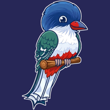
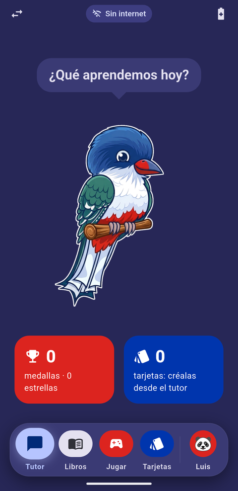
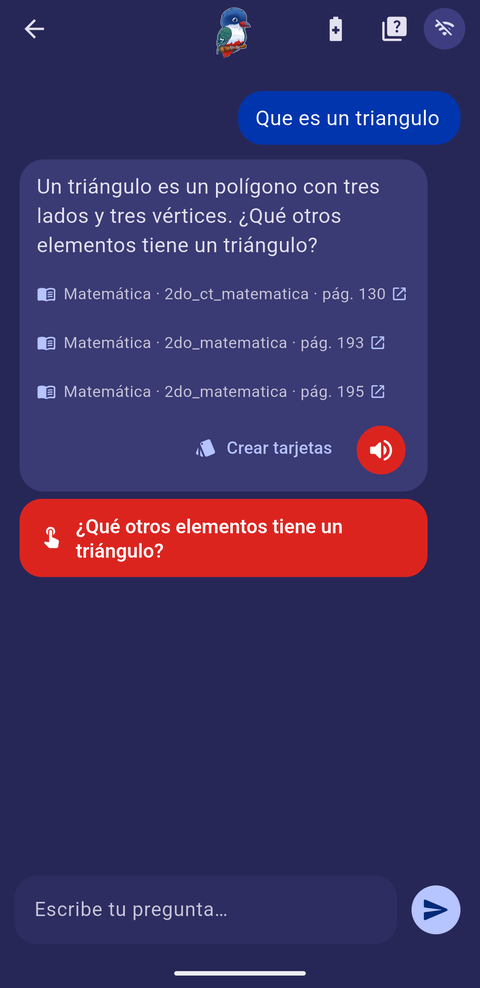
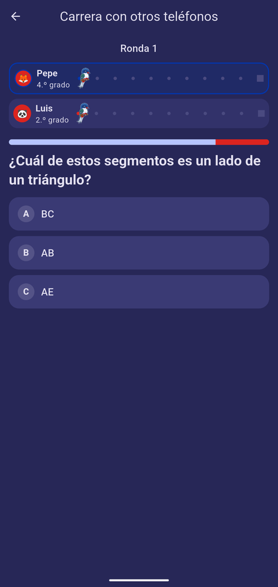

<div align="center">



# inocencIA

**Un tutor con inteligencia artificial que funciona sin internet,<br>para niños cubanos de 1.º a 6.º grado.**

[](https://github.com/atomwhyred/inocencia/releases/latest)


[](LICENSE)

[**Descargar**](#descargas) · [Web](https://atomwhyred.github.io/inocencia/) · [Guía para padres](docs/guia-padres.md) · [Telegram](https://t.me/elrincondeatomwhyred)

<br>

&nbsp;&nbsp;
&nbsp;&nbsp;


</div>

---

## En resumen

- 📚 **Responde con sus libros de texto.** El niño pregunta lo que no entiende y el tutor le explica con el libro
  cubano de su grado, citando la página.
- 🧭 **Enseña, no copia.** Da un paso y hace una pregunta; ante un ejercicio no lo resuelve, ayuda a empezarlo.
- 📵 **100 % sin internet.** La IA vive dentro del teléfono o la tablet. Sin cuentas, sin anuncios, nada sale del
  dispositivo.
- 🐦 **Toco, el tocororo**, acompaña al niño: duerme, piensa, se alegra y lo anima.
- 🔒 **Zona de padres con PIN** para los perfiles, los archivos y los ajustes.

> **Estado:** versión de pruebas **1.0.1**. Probada en un Pixel 6, un Redmi Note 9 y una Xiaomi Pad 5.

## Descargas

La app no trae dentro el modelo de IA ni los libros (pesan demasiado): se descargan una vez y se copian al
teléfono.

| | Qué es | Descarga |
|---|---|---|
| 📱 **La app** | APK para Android 10 o superior. Casi todos los móviles usan `arm64-v8a`. | [GitHub › Releases](https://github.com/atomwhyred/inocencia/releases/latest) |
| 🧠 **Modelo de IA** (recomendado) | **Qwen2.5-3B-Instruct Q4_0** · `qwen2.5-3b-instruct-q4_0.gguf` · 2,0 GB | [Telegram](https://t.me/elrincondeatomwhyred/962) |
| 🗂️ **Base de datos** | `knowledge.db`: el contenido de los libros preparado para el tutor | [Telegram](https://t.me/elrincondeatomwhyred/966) |
| 📖 **Libros** | Los PDF de los libros de texto, para leerlos dentro de la app | [Telegram](https://t.me/elrincondeatomwhyred/968) |

El modelo recomendado va bien en teléfonos y tablets con unos **8 GB de RAM**. En **Zona de padres › Archivos** la
app indica qué modelo conviene según la memoria del dispositivo y si el archivo es el oficial.

<details>
<summary>Comprobar que la APK no está alterada</summary>

Descarga también `SHA256SUMS` de la misma versión y, en la carpeta de descargas:

```bash
sha256sum -c SHA256SUMS --ignore-missing
```

</details>

## Cómo empezar

1. **Instala la APK** en el teléfono o la tablet.
2. **Crea tu nombre y un PIN** de 4 o 6 dígitos (es la llave de la zona de padres).
3. **Copia los archivos** (modelo, `knowledge.db` y los PDF) al dispositivo, o pásalos desde otro teléfono que ya
   tenga la app con **Compartir / Copiar a…**
4. Entra a **Zona de padres › Archivos › Detectar** para vincularlos.
5. **Crea el perfil del niño** y que entre a **Mi tutor**.

Guía completa con capturas y solución de problemas: [docs/guia-padres.md](docs/guia-padres.md) ·
guías cortas: [docs/guias/](docs/guias/README.md).

## Qué hace

| | |
|---|---|
| 💬 **Mi tutor** | Chat con la IA local. Respuestas cortas, con el libro y la página de donde salen. |
| 📖 **Mis libros** | Lector de los PDF originales; recuerda la página de cada niño. |
| 🔊 **Lectura en voz alta** | Lee las respuestas con la voz del dispositivo. |
| ❓ **Quiz** y 🃏 **Mis tarjetas** | Preguntas y tarjetas de memoria del tema estudiado, sacadas del libro. |
| 🏅 **Mis medallas** | Medallas y estrellas por aprender y practicar. |
| 🍅 **Pomodoro infantil** | Estudio y descanso según la edad (15+5 o 20+5 minutos). |
| 🎮 **Carrera de tocororos** | Juego en un teléfono o entre varios del mismo Wi-Fi. |
| 🔋 **Modo apagón** | Tema negro y tutor más ligero para ahorrar batería. |

## Privacidad

- **No se conecta a internet.** El permiso de red solo existe porque Android lo exige para el juego entre teléfonos
  del mismo Wi-Fi.
- **Los datos del niño no salen del dispositivo** y no se copian a la nube.
- **Sin cuentas, sin anuncios, sin rastreo.**

## Bueno saber

- El tutor tarda **unos 30-40 s** por respuesta y el teléfono puede calentarse tras varias preguntas seguidas.
- Una IA pequeña **puede equivocarse**: por eso siempre cita la página del libro.
- Para la voz en español hay que tener instalados los datos de voz en español de Android.
- La versión de 32 bits (`armeabi-v7a`) aún no se ha probado en un teléfono real.

Lo pendiente: [docs/pendiente.md](docs/pendiente.md).

## Para desarrolladores

App Flutter con IA local (llama.cpp) y búsqueda en los libros con SQLite FTS5.

```bash
git clone https://github.com/atomwhyred/inocencia.git && cd inocencia
flutter pub get
native/llama/build_android.sh arm64-v8a   # compila llama.cpp para Android (una vez)
flutter test && flutter run
```

Todo lo técnico (arquitectura, preparar los datos, compilar y firmar, estructura del código, pruebas, seguridad)
está en **[docs/desarrollo.md](docs/desarrollo.md)**. Más documentación:
[modelos](docs/models.md) · [libros](docs/libros.md) · [mascota](docs/mascota.md) · [juego](docs/juego.md) ·
[base de conocimiento](docs/knowledge_db_schema.md) · [publicar](docs/publicar.md).

Las ideas y los fallos son bienvenidos en [issues](https://github.com/atomwhyred/inocencia/issues).

## Licencia y créditos

El código se distribuye bajo la **licencia Apache 2.0** ([LICENSE](LICENSE) y [NOTICE](NOTICE)). La licencia cubre
el código, no los modelos ni los libros, que tienen sus propios términos.

- Modelos **Qwen2.5** (Alibaba Cloud): Apache-2.0 (1.5B y 7B) y licencia Qwen Research (3B).
- **llama.cpp**, **llama_cpp_dart**, **PDFium** (vía `pdfrx`), **Flutter** y los paquetes de
  [pubspec.yaml](pubspec.yaml), cada uno con su licencia.
- Los **libros de texto** pertenecen a sus autores y editoriales y no forman parte de este repositorio.

La app está pensada para **niños**: no recoge datos, no tiene cuentas ni anuncios y no usa internet. Si la
distribuyes o la modificas, mantén ese principio.
