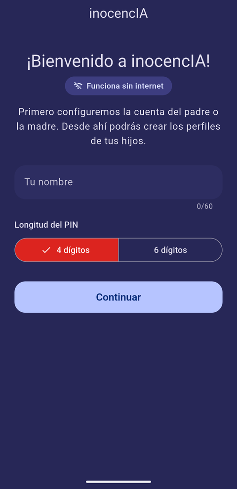
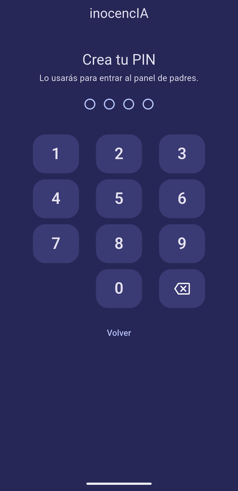
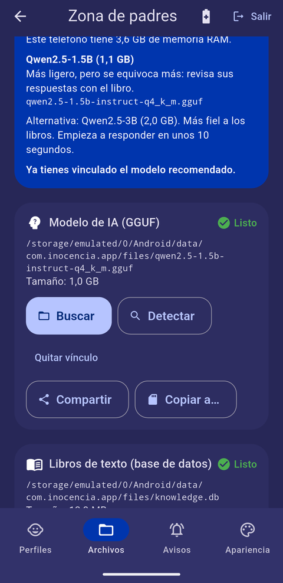
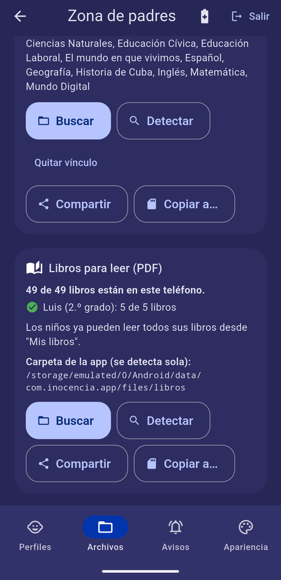
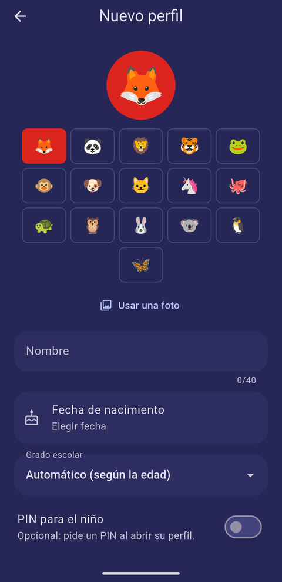
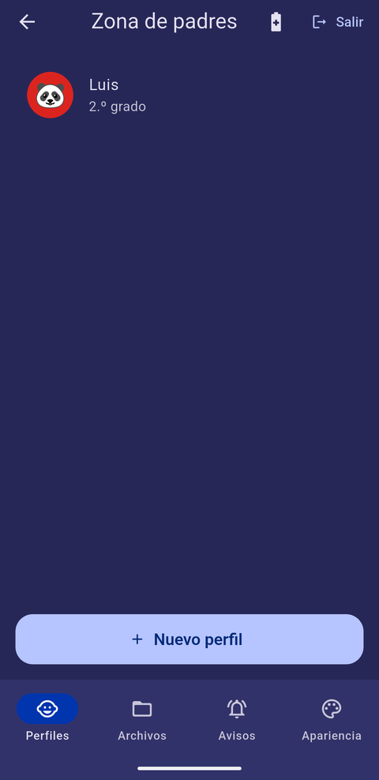

# 3. Primeros pasos (para el padre o la madre)

Esto se hace una sola vez, después de [instalar la app y copiar los archivos](02-descargar-e-instalar.md).

## 1. Tu nombre y tu PIN

La primera vez que abres la app te pide **tu nombre** y un **PIN de 4 o 6 números**. La app no acepta los PIN
obvios (0000, 1234, 1212…): elige uno que un niño no adivine.

Con ese PIN entras en la **Zona de padres**: es el **candado** de arriba a la derecha en la pantalla donde se
elige el perfil. **Apúntalo en un sitio seguro**: si lo olvidas, no se puede recuperar (habría que borrar los datos
de la app y empezar de nuevo).

 

Después verás la pantalla donde se elige el perfil. El **candado** de arriba a la derecha lleva a la Zona de padres:

## 2. Que la app encuentre los archivos

1. Entra en la **Zona de padres** (candado + PIN) → pestaña **Archivos**.
2. Arriba verás qué falta y **qué modelo recomienda** para la memoria de este teléfono.
3. En **Modelo de IA** y en **Base de libros** pulsa **Detectar** (o **Comprobar de nuevo**). Si los copiaste en
   la carpeta de la app, aparecen solos. Si hay varios modelos, te pregunta cuál usar.
4. En **Libros para leer (PDF)** pulsa **Detectar**. Si los PDF están en otra carpeta, pulsa **Buscar carpeta**,
   elígela y pulsa **Usar esta carpeta**.

 

Cuando todo está bien, el modelo y la base muestran **Listo** en verde y, debajo, **Archivo oficial de inocencIA** si
coinciden con los publicados (si dice **Archivo no reconocido**, puede ser una versión nueva u otro modelo; si no sabes
de dónde salió, vuelve a copiarlo desde el canal). En **Libros para leer** aparece
"*X de X libros están en este teléfono*" y el grado de cada niño con una marca verde.

## 3. Crear el perfil de cada niño

**Zona de padres → Perfiles → Nuevo perfil**: nombre, fecha de nacimiento, grado (de 1.º a 6.º) y un avatar.

- Cada niño tiene **su** historial, **su** página en cada libro, **sus** tarjetas y **sus** medallas.
- El tutor contesta con los libros **de su grado**.
- El grado sube solo cada curso.
- A un niño mayor le puedes poner su propio PIN.

 

## 4. Ajustes recomendados

En **Zona de padres**:

- **Apariencia**: tema claro u oscuro, tamaño de Toco, **Pomodoro** (descansos), **lectura en voz alta**,
  **modo batería** y **Enviar la foto en el juego en red** (apagado: en las partidas con otros teléfonos el niño sale
  con un emoji y su foto no sale del teléfono).
- **Avisos**: recordatorios para estudiar (puedes poner varios, cada uno con su interruptor).

## 5. Si el tutor va lento: la prueba de velocidad

Cada teléfono es distinto. La app puede medir cuál es la mejor forma de trabajar en el tuyo:

1. **Zona de padres → Archivos → Diagnóstico del tutor**.
2. Pulsa **Hacer la prueba**. Tarda 1 o 2 minutos. **No salgas de la app mientras dura.**
3. La app guarda lo más rápido y lo usa desde entonces. **Volver a automático** lo deshace.

Haz la prueba otra vez si cambias de modelo.

## 6. La primera pregunta

Elige el perfil del niño y pulsa **Tutor** (o toca a Toco). La primera vez el modelo tarda un poco en cargar
("Preparando a tu tutor…").

Siguiente: [4. Cómo lo usa el niño](04-uso-para-ninos.md)
