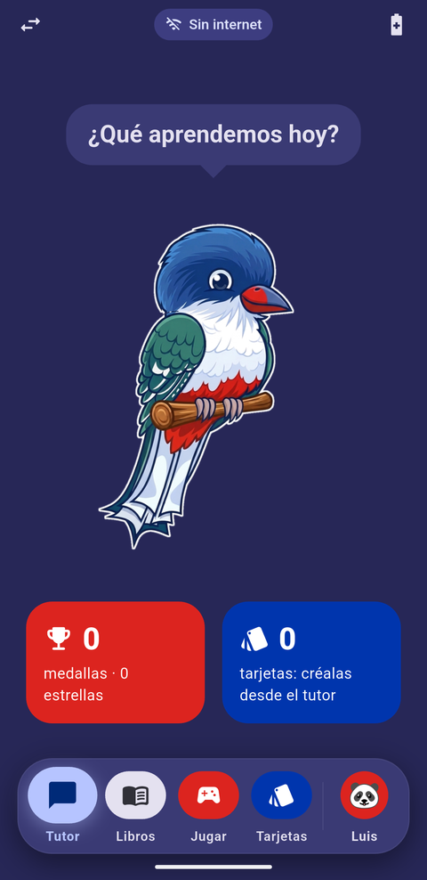
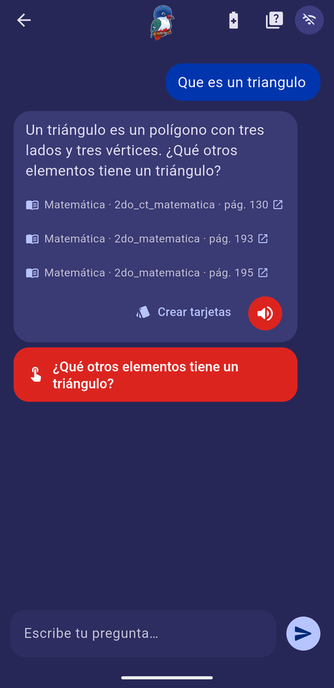

# 4. Cómo lo usa el niño

## El inicio

Al elegir su perfil, el niño ve a **Toco** preguntando "¿Qué aprendemos hoy?" y, debajo, sus **medallas** y sus
**tarjetas**. Abajo está la barra con **Tutor**, **Libros**, **Jugar**, **Tarjetas** y su foto (tocarla cambia de
perfil).

## Tutor

1. El niño escribe su pregunta, por ejemplo: *¿Qué es un sustantivo?* o *No entiendo las fracciones*.
2. El tutor contesta en 2 o 3 frases y **termina con una pregunta**. Esa pregunta aparece como botón: al tocarlo,
   el niño escribe su respuesta.
3. Debajo de la respuesta se ve **de qué libro y página sale**. Tocándolo se abre el libro en esa página.

Además:

- **Altavoz**: lee la respuesta en voz alta.
- **Crear tarjetas**: hace tarjetas de memoria sobre ese tema.
- **Quiz** (botón de arriba a la derecha): 3 preguntas de opción múltiple sobre el último tema. Da estrellas.

Mientras el tutor responde **puedes salir de la app o apagar la pantalla**: arriba aparece el aviso *"Toco está
pensando…"* y la respuesta sigue a buen ritmo. Cuando termina, otro aviso dice *"¡Toco ya terminó!"*; tócalo para
volver. **No cierres la app desde Recientes** (deslizándola hacia fuera): eso sí detiene la respuesta.

Cuánto tarda: con el modelo recomendado, unos 20-40 segundos en empezar a escribir, según el teléfono. Es normal:
todo se calcula dentro del teléfono, sin internet.

## Libros

Los libros del grado en PDF. Cada libro se abre en la página donde el niño lo dejó.

## Tarjetas

Tarjetas de memoria: la pregunta delante y la respuesta detrás (se tocan para darles la vuelta). Al repasar, el
niño marca **La sabía** o **A repasar**; las que falla vuelven a salir.

Las tarjetas se crean desde el tutor con **Crear tarjetas**. Conviene que un adulto les eche un vistazo: el modelo a
veces escribe alguna incompleta.

## Medallas

Se abren tocando la tarjeta de medallas del inicio. Hay medallas por el primer tema, el primer quiz, por aciertos,
por completar una sesión de estudio y por estudiar tres días seguidos. Cada acierto da una estrella.

## Pomodoro (descansos)

Tras **15 minutos** de estudio (20 minutos de 4.º a 6.º), Toco avisa de que toca descansar **5 minutos**. El chat se
bloquea hasta que acaba el descanso. Se activa o se quita en **Zona de padres → Apariencia**.

## Modo batería

El **icono de batería** de arriba pone la pantalla negra, deja a Toco quieto y hace el tutor más ligero, para
gastar menos. Útil en los apagones.

Con menos del **20 %** de batería, **Toco lo propone** ("Queda poca batería. ¿Ahorramos energía?") con dos
botones: **Ahorrar** o **No, gracias**. Nunca se activa solo.

## Lectura en voz alta

Usa la voz del propio teléfono, sin internet. Hace falta tener la **voz en español** instalada. Si la app avisa de
que no hay voz, mira [Problemas y soluciones](06-problemas-y-soluciones.md).

Siguiente: [5. Jugar](05-jugar.md)
