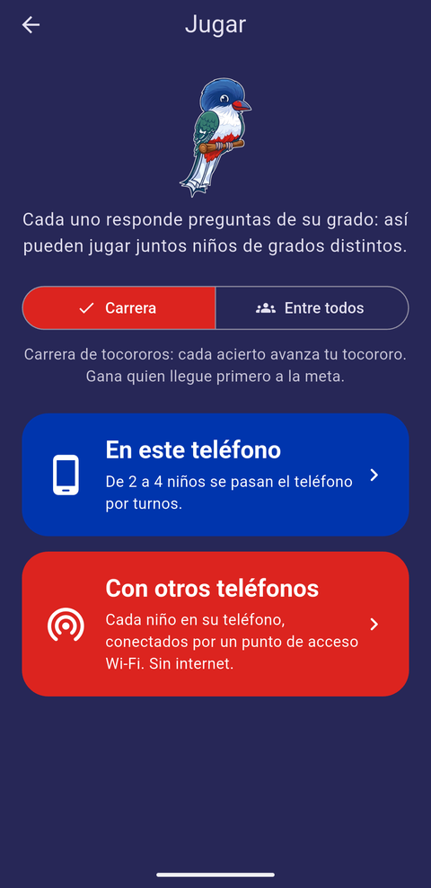
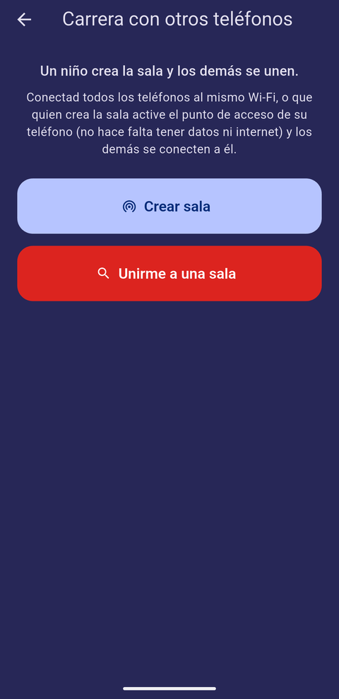
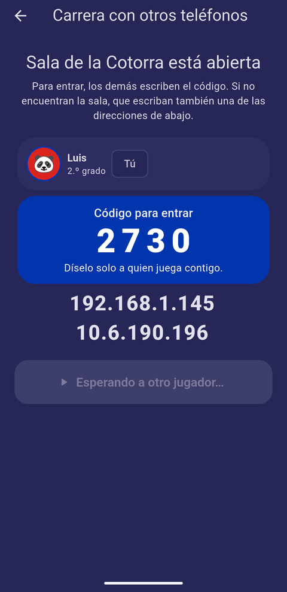
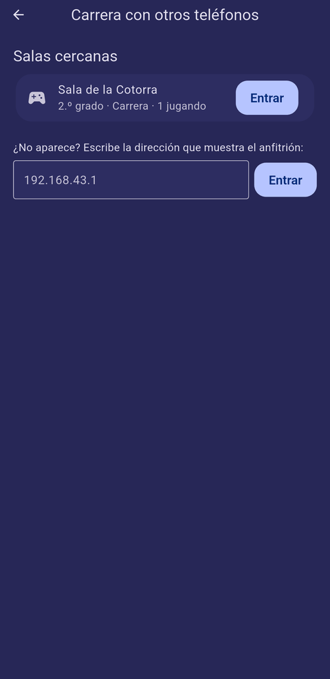
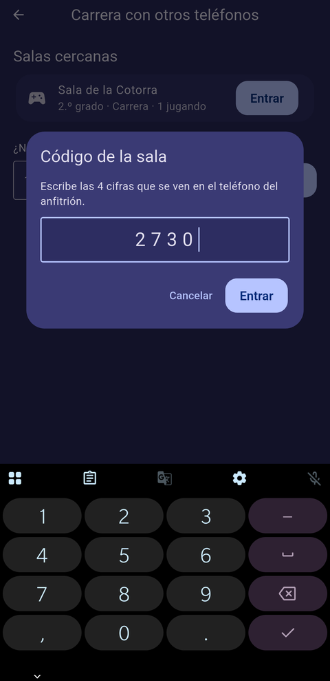
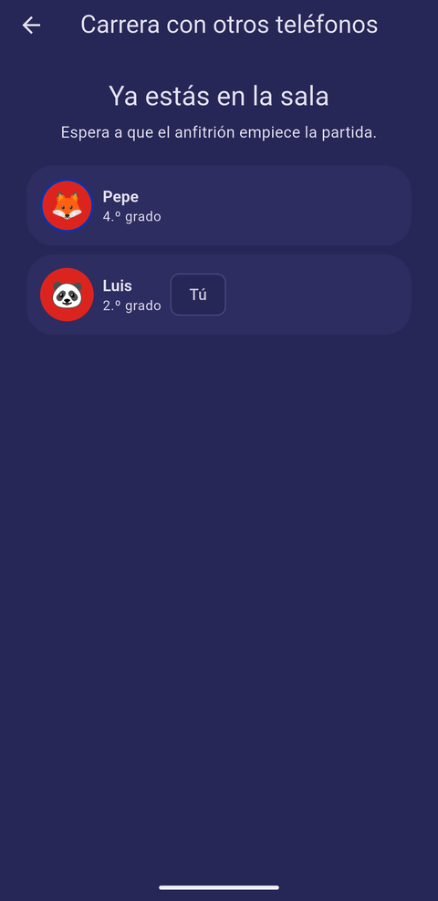
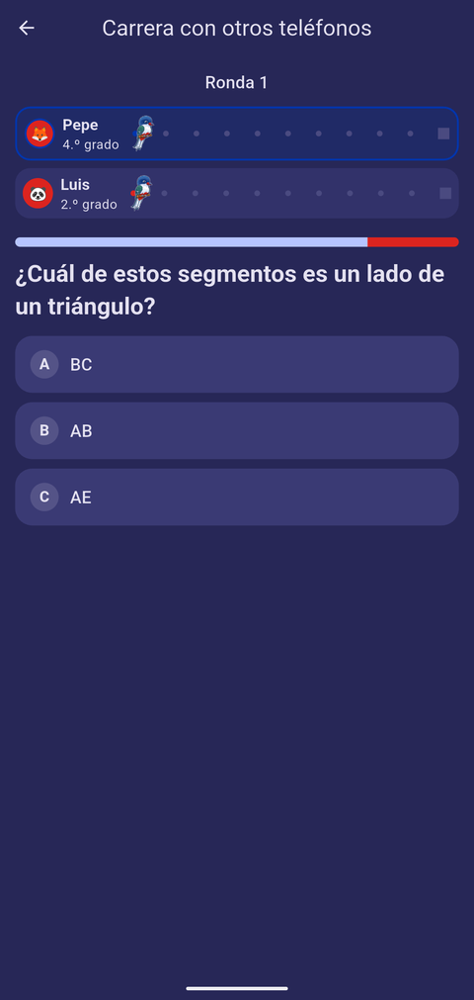

# 5. Jugar

En **Jugar** los niños repasan jugando, sin internet. **Cada niño responde preguntas de su propio grado**: un niño
de 2.º puede jugar con uno de 6.º.

Se entra desde el botón **Jugar** de la barra de abajo. Arriba se elige el juego y debajo dónde jugar:

## Dos juegos

- **Carrera**: gana quien llegue antes a la meta. Cada acierto avanza una casilla (dos si la pregunta es de una
  tarjeta suya).
- **Entre todos**: juegan en equipo. Los aciertos de todos ayudan a Toco a llegar a su nido.

Al terminar, todos ganan estrellas: una por jugar y más por acertar y por ganar.

## Dónde jugar

### En este teléfono

De **2 a 4 niños** con perfil en el mismo teléfono se lo pasan por turnos. La app avisa a quién le toca.

### Con otros teléfonos

Cada niño en su teléfono (hasta 6). **No hace falta internet ni datos**: basta con que estén conectados a la
**misma red Wi-Fi** o al **punto de acceso** de uno de los teléfonos.

1. Uno de los teléfonos activa su **punto de acceso** (o todos se conectan al mismo Wi-Fi de casa o de la escuela).
2. En ese teléfono: **Jugar → Con otros teléfonos → Crear sala**.

 

   La pantalla muestra el **nombre de la sala** (por ejemplo "Sala del Sinsonte") y un **código de 4 cifras**.
3. En los demás: **Jugar → Con otros teléfonos → Unirme a una sala**. La sala aparece sola. Si no aparece, escribe
   la dirección que se ve en el teléfono que creó la sala. Al pulsar **Entrar**, escribe el **código** que se ve en
   el teléfono que creó la sala. Así no se cuela nadie que esté en el mismo Wi-Fi.

 

4. Cuando estén todos, el que creó la sala pulsa **¡Empezar!** y empieza la partida.

Ya jugando, cada niño ve **su** pregunta (del libro de su grado) y su tocororo avanza con cada acierto:

Cada teléfono necesita la app con su **base de libros** (`knowledge.db`) y un perfil de niño.

Si el niño tiene foto en su perfil, en el juego en red sale con un emoji. Para que los demás vean una miniatura de su
foto, actívalo en **Zona de padres → Apariencia → Enviar la foto en el juego en red**. Todos los teléfonos de la
partida tienen que tener la misma versión de inocencIA.

## El permiso de red

Para jugar entre teléfonos, Android obliga a que la app tenga el permiso de red, aunque solo se hable con teléfonos
de la misma casa o aula. **inocencIA nunca se conecta a internet**: solo habla con los otros teléfonos del juego, y
solo mientras hay una partida abierta.

## Si algo falla

- **No aparece la sala**: comprobad que todos están en el mismo Wi-Fi o punto de acceso y que todos tienen la misma
  versión de inocencIA. Algunas redes no dejan anunciar salas: escribid a mano la dirección que muestra el teléfono
  que creó la sala y, al entrar, el código.
- **"El código de la sala no es ese"**: mira bien las 4 cifras en el teléfono que creó la sala. Tras 5 códigos
  equivocados desde un mismo teléfono ya no lo dejan entrar mientras esa sala siga abierta: cerrad la sala y crea
  otra.
- **La sala desapareció de la lista**: se borra sola cuando el que la creó deja de anunciarla (por ejemplo, porque ya
  empezó la partida o salió de la sala).
- **"No se pudo abrir la sala"** o no se puede entrar: puede que el teléfono tenga bloqueado el acceso a la red para
  inocencIA. Actívalo en *Ajustes › Aplicaciones › inocencIA › Datos móviles y Wi-Fi*.
- **"No hay preguntas para jugar"**: la base de libros no trae las preguntas del juego y el niño tiene menos de 3
  tarjetas. Crea tarjetas desde el tutor o descarga del canal la última `knowledge.db`.

Siguiente: [6. Problemas y soluciones](06-problemas-y-soluciones.md)
